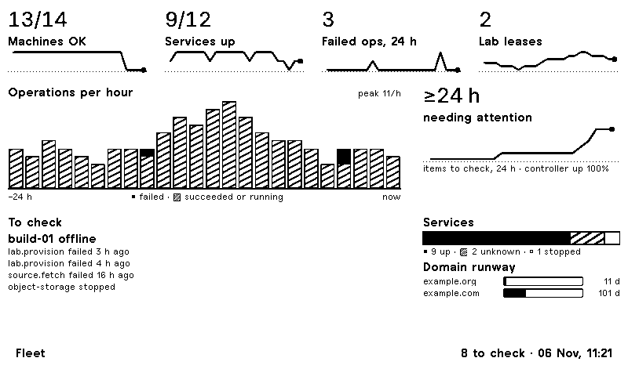
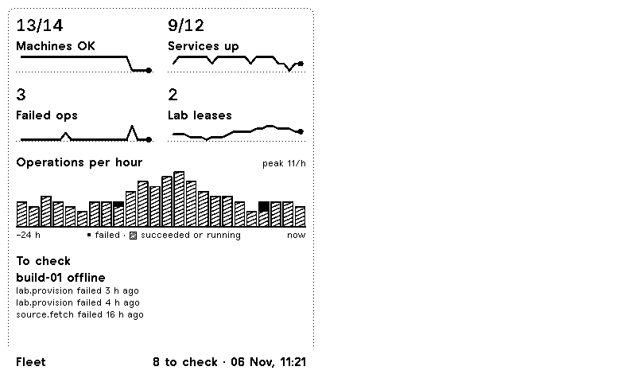
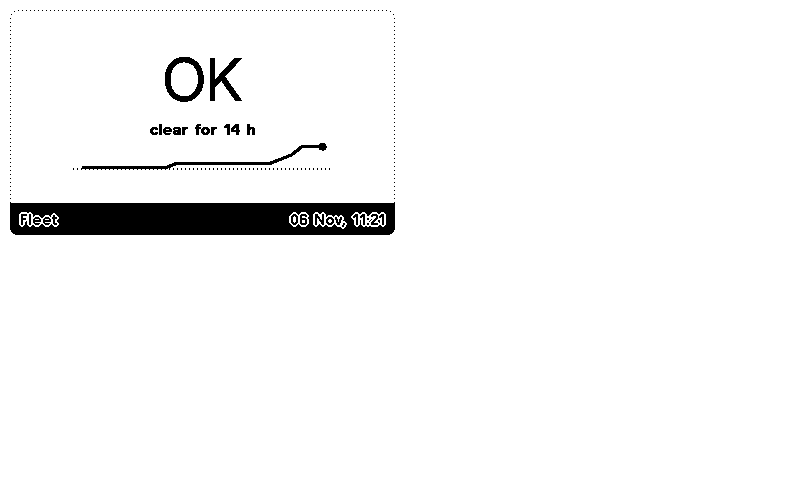
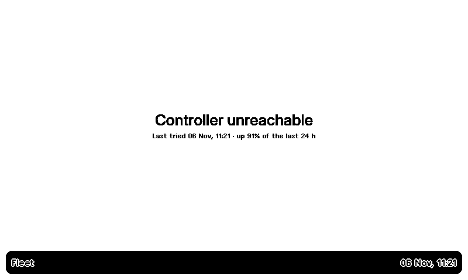

# Fleet on a TRMNL display

A TRMNL private plugin that shows the fleet's state on an e-ink screen, and a
small publisher that feeds it.

```
Fleet controller ──GET /api/v1/…──▶ publish.mjs ──POST merge_variables──▶ TRMNL webhook ──▶ screen
     (LAN / tailnet)                (every 10 min)                         (trmnl.com)
```

The publisher only reads Fleet's public API and pushes outbound, so the
controller stays off the Internet. Its trusted-LAN mode makes every caller an
administrator, so do not switch the plugin to TRMNL's polling strategy, which
would need TRMNL's servers to reach the controller.

## What the screen shows



| Layout | Content |
|---|---|
| Full (800×480) | Four headline numbers, each with a 24-hour sparkline (machines OK, services up, failed operations, Lab leases); operations started per hour as stacked bars (failures in black); how long the fleet has been all clear (or not) with the trend of items to check and the controller's availability; the items to check; services as a split bar; the runway to the soonest domain expiries |
| Half horizontal | The headline sparklines and the items to check on one line |
| Half vertical | The headline sparklines in a 2×2 grid, the operations chart and the items to check |
| Quadrant | The number of items to check (or OK and the clear streak) over its trend |

| Half vertical | Quadrant, all clear | Controller unreachable |
|---|---|---|
|  |  |  |

These conditions are listed as items to check: an offline or stale machine,
an operation that failed within the window, a Lab lease whose cleanup failed,
a stopped service, a machine with drift, a domain near expiry, an action
request awaiting approval, a failing storage check, and an unreachable
controller. Sections the API could not answer appear as "No data", and the
rest of the screen still renders.

The charts are inline SVG drawn by the Liquid templates, with no JavaScript,
so what `trmnlp build --png` renders is what the device shows.

### Trend history

Fleet keeps no history of these numbers, so the publisher does. Each run
appends one sample (controller up, items to check, machines OK, services up,
active Lab leases) to a small JSON file and keeps the last 25 hours. Under
systemd that is `/var/lib/fleet-trmnl/history.json`. Without a state file,
the sparklines and the streak show "no history yet" and everything else
still works. Deleting the file only blanks the trends. The operations chart
needs no history: it is built from the controller's operation list on every
run.

For Claude and Codex usage, add one of the community plugins to the same
playlist, or combine it with this one in a TRMNL mashup (this plugin has every
mashup layout). [Claude Usage](https://thecarledwards-site.pages.dev/posts/claude-usage-trmnl)
covers Claude, and [trmnl-agent-usage](https://github.com/JakeDefayette/trmnl-agent-usage)
covers Claude, Codex and Gemini. Both are community projects that Fleet does
not maintain or review.

## Data that leaves your network

The payload (about 2 KB) holds counts, the chart series, the controller version, the short
desired-state commit, and the item-to-check lines. Those lines name
machines, services, domains and operation kinds. Set `FLEET_TRMNL_NAMES=0` to
send counts only. Addresses, endpoints, secrets and command output are never
sent. Run `node publish.mjs --dry-run` to see exactly what would be posted.

## Setup

### 1. Create the plugin in TRMNL

Either path works:

- **With [trmnlp](https://github.com/usetrmnl/trmnlp)** (Docker or `gem install trmnl_preview`):
  `cd plugin && trmnlp login && trmnlp push`. The first push creates the
  plugin. Copy its id into `src/settings.yml` as `id: …`, or each later push
  creates another plugin.
- **By hand**: in TRMNL, go to Plugins → Private Plugin → New, choose the
  **Webhook** strategy and save. Then, in Edit Markup, paste
  `plugin/src/shared.liquid` into the Shared tab and each layout file into its
  tab.

Your account needs a device with Developer edition enabled, or the webhook
answers 403.

### 2. Store the webhook URL

Open the plugin's settings and copy its Webhook URL
(`https://trmnl.com/api/custom_plugins/<uuid>`). Anyone who has the URL can
write to your screen, so treat it as a secret:

```sh
sudo install -d -m 700 /etc/fleet-trmnl
sudo install -m 600 /dev/stdin /etc/fleet-trmnl/webhook   # paste the URL, then Ctrl-D
sudo install -m 644 systemd/env.example /etc/fleet-trmnl/env
sudoedit /etc/fleet-trmnl/env                              # set FLEET_URL
```

### 3. Install the publisher

Install it on any always-on Linux host that has Node 20 or later and can
reach the controller, such as the controller host itself or another machine
on the tailnet:

```sh
sudo install -d /opt/fleet-trmnl
sudo install -m 644 publish.mjs summary.mjs history.mjs README.md /opt/fleet-trmnl/
sudo install -m 644 systemd/fleet-trmnl.service systemd/fleet-trmnl.timer /etc/systemd/system/
sudo systemctl daemon-reload
sudo systemctl start fleet-trmnl.service && journalctl -u fleet-trmnl -n 5   # one run now
sudo systemctl enable --now fleet-trmnl.timer
```

The timer posts every 10 minutes. TRMNL accepts 12 posts an hour (30 with
TRMNL+), and the screen picks up new data at its next refresh.

To run it without systemd (cron, a container, a one-off), set the environment
variables and run `node publish.mjs`.

## Settings

| Variable | Default | Meaning |
|---|---|---|
| `FLEET_URL` | required | Controller base URL, such as `http://127.0.0.1:8080` |
| `TRMNL_WEBHOOK_URL_FILE` | `$CREDENTIALS_DIRECTORY/trmnl-webhook` | File holding the webhook URL |
| `TRMNL_WEBHOOK_URL` | | The URL itself (prefer the file) |
| `FLEET_TRMNL_TIME_ZONE` | host zone | IANA zone for the "updated" time |
| `FLEET_TRMNL_NAMES` | `1` | `0` sends counts only |
| `FLEET_TRMNL_WINDOW_HOURS` | `24` | Window for succeeded and failed operations |
| `FLEET_TRMNL_EXPIRY_DAYS` | `30` | Flag domains expiring within this many days |
| `FLEET_TRMNL_MAX_BYTES` | `5000` | Payload limit (`10000` with TRMNL+) |
| `FLEET_TRMNL_STATE_FILE` | `$STATE_DIRECTORY/history.json` | Trend history; unset outside systemd means no sparklines |

The operation counts cover the newest 200 operations, which is the most the
API returns in one page.

## Developing the screen

```sh
cd plugin
trmnlp serve                  # http://localhost:4567, renders the sample data in .trmnlp.yml
trmnlp build --png            # writes _build/*.png
trmnlp lint
node --test "../*.test.mjs"
```

`node ../sample.mjs` regenerates the sample `variables:` block: a made-up
fleet with a day of history, run through the real summary and trend code.

To preview real data, remove the `variables:` block from `.trmnlp.yml` (it
overrides what the webhook stores), then run
`FLEET_URL=… TRMNL_WEBHOOK_URL=http://localhost:4567/webhook FLEET_TRMNL_STATE_FILE=/tmp/fleet-trmnl.json node ../publish.mjs`.
